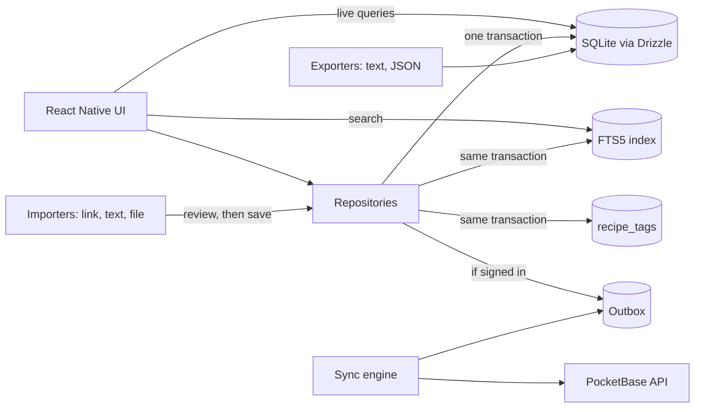

# Ladleful

**A recipe box that works in the kitchen with no data, builds your shopping list, and lets you take your recipes with you.**


<!-- Add after build: docs/media/demo.gif and 4 screenshots (library, recipe, cooking mode, shopping list) -->

## Why this exists

Recipes live everywhere: bookmarked pages, screenshots, chat messages, a relative's handwriting. When you are standing in the kitchen with patchy data, the page will not load, the ads cover the steps and the screen goes to sleep with flour on your hands.

Ladleful keeps every recipe on the phone. Search is instant, quantities scale to the number of people eating, cooking mode keeps the screen awake with big steps and timers, and a few taps turn several recipes into one merged shopping list. Your recipes are yours: import from a link, from pasted text or from a backup file, and export any time.

## Features

- Recipe library with instant full-text search across titles, ingredients, tags and notes
- Quick filters: favorites, under 30 minutes, tags
- Write a recipe fast: type ingredients one per line and see them understood live
- Import from a web link (pages that publish structured recipe data), pasted text, or a Ladleful backup file
- Servings scaler with friendly fractions
- Cooking mode: large steps, screen stays awake, ingredient sheet, timers suggested from the step text
- Shopping lists built from recipes: quantities merged, grouped by aisle, pantry staples skipped
- Share a recipe or a shopping list as plain text (works in any chat app)
- Full backup and restore as a versioned JSON file
- Optional account for backup and multi-device sync
- Light and dark themes, large touch targets, screen reader support

## How it works

1. Every screen reads from local SQLite, so nothing waits on the network.
2. A recipe is stored as one document (ingredients and steps as structured data). A derived full-text index and tag table are updated in the same transaction as every write.
3. A pure parser turns lines like "1 1/2 cups rice, rinsed" into quantity, unit, name and note. Pure functions handle unit conversion, merging, scaling and formatting.
4. Imports parse untrusted input (web pages, text, files), validate it and show a review screen before anything is saved.
5. If you sign in, an outbox syncs recipes and lists to a PocketBase backend.

Full detail: [docs/architecture.md](docs/architecture.md).

## Tech stack

| Layer | Choice |
|---|---|
| App | React Native with Expo, TypeScript (strict), Expo Router |
| Local data | expo-sqlite (with FTS5 full-text search) and Drizzle ORM |
| UI state | Zustand (UI-only state) |
| Lists and motion | FlashList, Reanimated, Gesture Handler, Expo Haptics |
| Kitchen features | expo-keep-awake, expo-notifications (timers, P1) |
| Files and sharing | expo-file-system, expo-document-picker, React Native Share |
| Images (P1) | expo-image, expo-image-picker, expo-image-manipulator |
| Validation | zod (import file schema) |
| Secure storage | expo-secure-store (auth token) |
| Connectivity | @react-native-community/netinfo |
| Backend | PocketBase with hooks |
| Errors | Sentry SDK pointed at self-hosted GlitchTip (optional) |
| Tests | Jest |

Everything is free and self-hostable. No paid services, no analytics SDKs.

## Architecture



## Getting started

### Prerequisites

- Node.js LTS and npm
- Android emulator or a phone with Expo Go
- A PocketBase binary (pinned version in `backend/PB_VERSION`), only for the optional sync

### Run the app (local-only)

```bash
npm install
cp .env.example .env
npx expo start
```

### Run the backend (optional)

```bash
cd backend
./pocketbase superuser create you@example.com 'choose-a-strong-password'
./pocketbase serve --http=0.0.0.0:8090
```

(On older PocketBase versions the command is `admin create`.) Set `EXPO_PUBLIC_API_URL` in `.env`:

| Device | URL |
|---|---|
| Android emulator | `http://10.0.2.2:8090` |
| Phone on the same Wi-Fi | `http://<your-computer-LAN-IP>:8090` |
| Phone over USB (after `adb reverse tcp:8090 tcp:8090`) | `http://localhost:8090` |

Use HTTPS beyond local demos.

### Scripts

| Command | Purpose |
|---|---|
| `npm start` | Start Expo |
| `npm test` | Run unit and integration tests |
| `npm run typecheck` | TypeScript check |
| `npm run lint` | ESLint |
| `npm run db:generate` | Generate a Drizzle migration after schema changes |

## Project structure

```text
ladleful/
  app/                 Expo Router routes (screens only)
  src/
    db/                Drizzle schema, migrations, repositories, search index
    domain/            ingredient parser, units, quantity format, scaling, merge, timers (pure)
    import/            jsonld extractor, link importer, text importer, backup importer
    export/            share text, markdown, backup builder
    sync/              outbox, engine, push, pull, backoff, merge
    api/               PocketBase client, auth, error mapping
    features/          screen components and hooks by feature
    ui/                design tokens and shared components
    lib/               ids, clock, logger, html helpers
    data/              aisle catalog, units table, starter recipes
  backend/
    pb_hooks/          validation and conflict guard hooks
    pb_migrations/     collections and API rules as code
  docs/                design, story, demo, prd, cursorcontext, architecture
```

## Testing

`npm test` covers the ingredient parser (60+ cases), unit conversion and merging, quantity formatting and scaling, timer detection, ISO duration parsing, structured-data extraction from HTML fixtures, the text importer, backup schema validation and import conflicts, the search query builder, the shopping list merge, share text formatting and the sync engine against a fake server with injected failures. The manual matrix is in [docs/architecture.md](docs/architecture.md#14-testing-strategy).

## Known limitations

- Link import only works for pages that publish structured recipe data; others need paste-text import
- Quantities written inside step text are not scaled
- Unit merging does not convert between metric and cup/spoon measures, and local measures (for example derica, tin, bunch) are kept as written
- Cover images are local only in the first version (not synced, not in backups)
- Imported recipes are for personal use; the app keeps the source link and includes it when you share
- The local database is not encrypted at rest
- Last-write-wins sync per record

## Roadmap

- Photos in backups and image sync
- Receive links from the system share sheet
- Public share links
- Meal planning
- Backend move to Go or Python with Postgres using the same protocol

## Documentation

| Doc | Contents |
|---|---|
| [prd.md](docs/prd.md) | Problem, scope, user stories, acceptance criteria |
| [design.md](docs/design.md) | UI/UX, tokens, screens, patterns replicated |
| [architecture.md](docs/architecture.md) | Data model, search, parsing, import and export, sync |
| [story.md](docs/story.md) | The narrative and interview talking points |
| [demo.md](docs/demo.md) | Demo script and recording guide |
| [cursorcontext.md](docs/cursorcontext.md) | Instructions for the AI coding agent |

## License

MIT