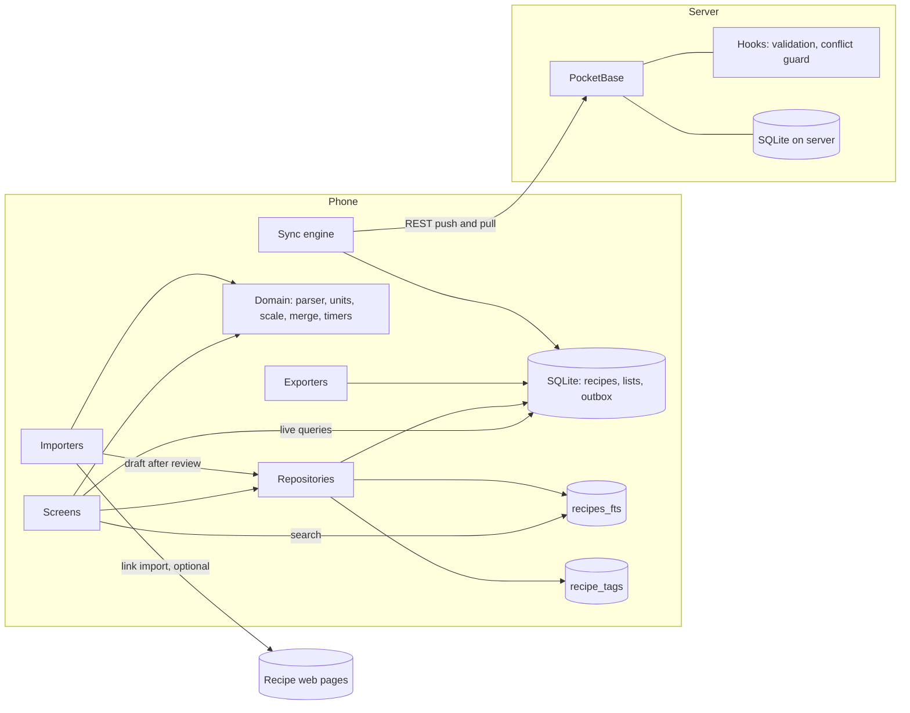
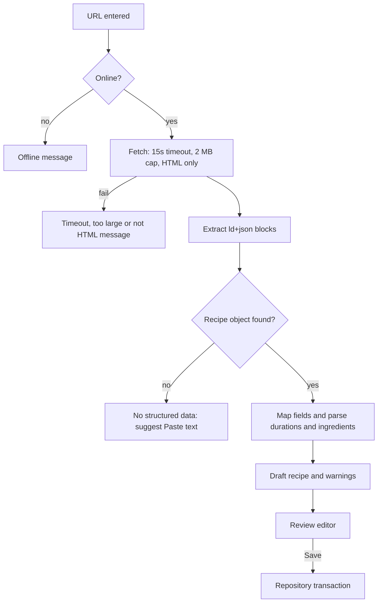

# Ladleful: Architecture

## 1. Overview and principles

Ladleful is local-first. The device database is the source of truth. The server is an optional backup and sync target for one user across devices.

| Principle | Where it lives |
|---|---|
| Offline reads | `src/db`, `src/domain`: every read, search, scale and merge runs locally |
| Derived data kept consistent | `recipes_fts` and `recipe_tags` updated in the same transaction as the recipe |
| Pure, tested domain logic | `src/domain`, `src/import`, `src/export` |
| Untrusted input handling | Importers: limits, schema validation, review before save |
| Portability and versioning | Versioned backup JSON, round-trip tested |
| Preserve source data | `raw` ingredient line always retained |
| Robust time handling | Timers use absolute end times |
| Queue-and-retry writes | `src/sync/*` (optional) |
| Idempotency | Client IDs, duplicate-as-success |
| Graceful degradation | Everything but link import works with no network |
| Error handling and resilience | Typed results, error taxonomy, route error boundaries |
| Secure storage | `expo-secure-store` for tokens; owner-scoped server rules |
| Observability | Logger interface with optional GlitchTip |

## 2. System context



## 3. Client architecture

Layers: **routes** (`app/`), **features** (hooks and components), **domain** (pure), **repositories** and **database**, with **import**, **export** and **sync/api** as the only modules that touch external data. Dependencies point downward.

State separation:
- Persistent domain data: SQLite
- UI-only state (Zustand): sheet visibility, theme preference, toasts, active search text, active cooking step, running timers cache
- Draft state: stored in `settings` (editor drafts keyed by recipe id or `new`)
- Sync status: derived from NetInfo, engine state, outbox counts, sign-in state

## 4. Local data model

Timestamps are integer milliseconds since epoch.

```sql
CREATE TABLE recipes (
  id TEXT PRIMARY KEY,
  title TEXT NOT NULL,
  description TEXT,
  servings REAL NOT NULL DEFAULT 4,           -- base servings
  prep_minutes INTEGER,
  cook_minutes INTEGER,
  ingredients TEXT NOT NULL,                  -- JSON array, see 4.1
  steps TEXT NOT NULL,                        -- JSON array, see 4.1
  notes TEXT,
  source_url TEXT,
  source_name TEXT,
  image_path TEXT,                            -- local only
  thumb_path TEXT,                            -- local only
  is_favorite INTEGER NOT NULL DEFAULT 0,
  times_cooked INTEGER NOT NULL DEFAULT 0,
  last_cooked_at INTEGER,
  created_at INTEGER NOT NULL,
  updated_at INTEGER NOT NULL,
  deleted_at INTEGER
);
CREATE INDEX idx_recipes_list ON recipes(deleted_at, updated_at DESC);

-- Local-only derived tables
CREATE TABLE recipe_tags (
  recipe_id TEXT NOT NULL,
  tag TEXT NOT NULL,                          -- normalized lowercase
  PRIMARY KEY (recipe_id, tag)
);
CREATE INDEX idx_tags_tag ON recipe_tags(tag);

CREATE VIRTUAL TABLE recipes_fts USING fts5(
  recipe_id UNINDEXED,
  title, ingredients, tags, notes,
  tokenize = 'unicode61 remove_diacritics 2',
  prefix = '2 3'
);

CREATE TABLE shopping_lists (
  id TEXT PRIMARY KEY,
  name TEXT NOT NULL,
  archived INTEGER NOT NULL DEFAULT 0,
  created_at INTEGER NOT NULL,
  updated_at INTEGER NOT NULL,
  deleted_at INTEGER
);

CREATE TABLE shopping_items (
  id TEXT PRIMARY KEY,
  list_id TEXT NOT NULL REFERENCES shopping_lists(id),
  name TEXT NOT NULL,                         -- display name
  merge_key TEXT NOT NULL,                    -- normalized name plus family key
  quantity REAL,
  unit TEXT,
  aisle TEXT NOT NULL DEFAULT 'other',
  checked INTEGER NOT NULL DEFAULT 0,
  origin TEXT NOT NULL CHECK (origin IN ('recipe','manual')),
  sources TEXT,                               -- JSON [{recipeId, title, qty, unit}]
  note TEXT,
  sort_order REAL NOT NULL DEFAULT 0,
  created_at INTEGER NOT NULL,
  updated_at INTEGER NOT NULL,
  deleted_at INTEGER
);
CREATE INDEX idx_items_list ON shopping_items(list_id, deleted_at, aisle);

CREATE TABLE settings (
  key TEXT PRIMARY KEY,   -- theme, pantry_staples, active_timers, drafts, sync_owner_id
  value TEXT NOT NULL
);

CREATE TABLE outbox (
  seq INTEGER PRIMARY KEY AUTOINCREMENT,
  entity TEXT NOT NULL CHECK (entity IN ('recipe','shopping_list','shopping_item')),
  entity_id TEXT NOT NULL,
  op TEXT NOT NULL CHECK (op IN ('create','update','delete')),
  payload TEXT NOT NULL,
  attempts INTEGER NOT NULL DEFAULT 0,
  next_attempt_at INTEGER NOT NULL DEFAULT 0,
  status TEXT NOT NULL DEFAULT 'pending' CHECK (status IN ('pending','parked')),
  last_error TEXT,
  created_at INTEGER NOT NULL
);

CREATE TABLE sync_state (
  key TEXT PRIMARY KEY,
  value TEXT NOT NULL
);
```

### 4.1 JSON shapes

```text
Ingredient: {
  raw: string,            // the original line, always kept
  qty: number | null,
  qtyMax: number | null,  // for ranges
  unit: string | null,    // canonical if known, otherwise as written
  name: string,
  note: string | null,
  group: string | null,   // group heading this line belongs to
  warn: boolean           // parser unsure
}
Step: { text: string }
```

Notes:
- Foreign keys on; migrations generated by `drizzle-kit`; FTS and tag tables are created with raw SQL in a migration.
- The outbox is only written when signed in; first sign-in enqueues existing data.
- FTS availability is verified in T1; the fallback is a `search_text` column with an index and `LIKE` prefix matching.

## 5. Domain logic (the specification)

### 5.1 Ingredient parser

`parseIngredient(line) -> Ingredient`

Steps:
1. Trim; remove list markers (`-`, `*`, bullets, leading numbering like `1.` only when followed by a space and a non-digit).
2. If the line ends with `:` and has no quantity, treat it as a group heading.
3. Normalize unicode fractions (`½` becomes 1/2, `1½` becomes 1 1/2), en dashes in ranges, and `to` in ranges.
4. Parse a leading quantity: integer, decimal, `a/b`, mixed `a b/c`, or range `x-y` / `x to y`.
5. Parse a unit: the next token (and `fl oz` style two-token units) matched case-insensitively against the unit table and aliases, with an optional trailing period. If the token is not in the table but follows a quantity and is followed by a name, keep it as a local unit only when it is a short word of letters (so "2 eggs" yields name "eggs" and no unit; "2 derica rice" yields unit "derica"). Rule of thumb in code: units not in the table are accepted only if the line has a quantity and at least two more tokens remain; otherwise it is part of the name. Mark `warn = true` for accepted unknown units.
6. Parentheses: `(400 g)` becomes part of the note unless it contains the only quantity.
7. Split name and note at the first comma; strip leading `of`.
8. Lines like "salt to taste" or "pepper, optional" keep `qty = null`.
9. Always set `raw`. If no name remains, `name = raw` and `warn = true`.

### 5.2 Units

| Family | Units (canonical, with aliases) | Base |
|---|---|---|
| mass | g (gram, grams), kg (kilogram), oz (ounce), lb (pound, lbs) | g |
| volume_metric | ml (millilitre, milliliter), l (litre, liter) | ml |
| volume_spoon | tsp (teaspoon), tbsp (tablespoon), cup (cups) | tsp (1 tbsp = 3 tsp, 1 cup = 48 tsp) |
| count | none, piece, pieces, pc, pcs | count |
| other | clove, slice, pinch, bunch, tin, can, pack, packet, cube, stick, sprig, derica, and anything unknown | exact unit string only |

No conversion across families. Unit tables live in data files and are covered by tests.

### 5.3 Quantity formatting and parsing

`formatQuantity(value, unit)` follows the rules in `cursorcontext.md` section 6. Examples (tests): 1.5 cup becomes "1 1/2 cup" (using ½: "1½ cup"), 0.3333 tsp becomes "⅓ tsp", 2.6667 cup becomes "2⅔ cup", 1500 g becomes "1.5 kg", 12.4 count becomes "12". `parseQuantity` is the inverse for editing.

### 5.4 Scaling

`scaleIngredients(ingredients, baseServings, targetServings)` multiplies `qty` and `qtyMax` by the factor, leaving `qty = null` lines unchanged. The factor is `target / base`; servings must be positive. Step text is not scaled (documented in the UI).

### 5.5 Shopping merge

`mergeShopping(existingItems, incomingLines, pantry)`:
1. Skip incoming lines whose normalized name is in `pantry`; return the count skipped.
2. For each remaining line compute `merge_key` (normalized name plus family key).
3. If an existing recipe-origin item has the same key: convert both quantities to the family base, sum, reformat to a display unit; append the source; if the existing item was checked, uncheck it (more is needed).
4. If the key differs only by family (for example "milk 2 cup" and "milk 500 ml"), keep separate lines.
5. Lines with null quantity merge into one line with no quantity (for example "salt to taste").
6. Manual items never merge with recipe items, even on the same key.
7. Classify the aisle from the catalog (section 5.7).
8. Return the new item set, counts (added, combined, skipped).

### 5.6 Timers

`detectTimers(stepText)` finds durations (`N seconds|minutes|hours` and abbreviations, ranges use the upper bound) and returns `{label, seconds, start, end}` for chip rendering. A running timer is `{id, recipeId, stepIndex, label, endAt, pausedRemaining | null}` persisted in `settings.active_timers`; remaining time is `endAt - now`. Pausing stores `pausedRemaining` and clears `endAt`; resuming sets a new `endAt`. On app start, expired timers are shown as done once.

### 5.7 Aisle catalog

A static map of keywords to aisles in `src/data/aisles.ts` (about 150 entries, including common local ingredients such as egusi, ogbono, crayfish, palm oil, garri, yam, plantain, ugu, scotch bonnet, tatashe, iru and stockfish). Matching uses normalized names and word boundaries; default `other`. The catalog loads lazily on first use.

### 5.8 Share text

`shareText(recipe)` produces the plain-text format in `cursorcontext.md` section 7; `shareListText(list)` groups by aisle, one line per item with a checkbox marker for unchecked items.

## 6. Search and derived data

### 6.1 Index maintenance

On every recipe create, update, delete or import, inside the same transaction:
1. Upsert the recipe row.
2. Replace the recipe's `recipe_tags` rows with the normalized tags.
3. Delete and reinsert the recipe's `recipes_fts` row with: title, ingredient names and raw lines joined by spaces, tags joined, notes.
4. Soft-deleted recipes are removed from FTS and tags.

`rebuildSearchIndex()` drops and recreates both derived tables from the `recipes` table. It is used as the test oracle, after sync merges in bulk, after a backup import, and as a hidden repair action.

### 6.2 Query building

`buildQuery(text)`:
1. Lowercase, strip FTS operator characters (`"`, `*`, `(`, `)`, `:`, `-`, `^`), split on whitespace
2. Drop empty tokens; limit to 8 tokens
3. Build `"tok1"* AND "tok2"*` (each token quoted with a prefix star)
4. Empty query returns the unfiltered list ordered by `updated_at`

Execution joins FTS results (ranked by bm25 with the title weighted higher) with `recipes`, applies filters (favorite, total minutes at most 30, tag via `recipe_tags`) and limits to 200 results. Debounce keystrokes by about 120 ms.

### 6.3 Matched-ingredient caption

For the top results, show up to 3 ingredient names that match any query token (computed in JS from the parsed ingredients, not from FTS snippets).

## 7. Import and export

### 7.1 Link import



Mapping details:
- `name` to title; `description` to description; `image` (string, object with `url`, or first of an array) to a candidate image URL (downloaded only in P1 when a cover photo is saved)
- `recipeYield` (string, number or array) to the first number found, default 4
- `prepTime`, `cookTime` (ISO 8601 like `PT1H15M`) to minutes; `totalTime` used only when the others are missing
- `recipeIngredient` array to parsed ingredients
- `recipeInstructions` as a string (split on newlines), array of strings, array of `HowToStep` (`text` or `name`), or `HowToSection` with `itemListElement`
- `keywords` (comma string or array) and `recipeCategory` to tags (up to 8, deduplicated)
- `author` (string or object name) and the page URL to `source_name` and `source_url`
- HTML entities are decoded and tags stripped from text fields

Warnings: missing ingredients, missing steps, ingredient lines the parser flagged, unusually long text, yield not found.

### 7.2 Paste-text import

`splitPastedText(text)`: first non-empty line is the title; a heading line equal (case-insensitive, ignoring a trailing colon) to Ingredients or Ingredient list starts ingredients; Method, Steps, Directions, Instructions or Preparation starts steps; if no headings, return everything as steps with a warning and let the user adjust in the editor. Numbering prefixes and bullets are stripped.

### 7.3 Backup format (schemaVersion 1)

```json
{
  "app": "ladleful",
  "schemaVersion": 1,
  "exportedAt": 1764000000000,
  "recipes": [
    {
      "id": "abc123def456ghi",
      "title": "Tomato stew base",
      "description": null,
      "servings": 8,
      "prepMinutes": 15,
      "cookMinutes": 40,
      "ingredients": [{"raw": "6 large tomatoes", "qty": 6, "qtyMax": null, "unit": null, "name": "large tomatoes", "note": null, "group": null, "warn": false}],
      "steps": [{"text": "Blend the tomatoes."}],
      "notes": null,
      "sourceUrl": null,
      "sourceName": null,
      "tags": ["stew"],
      "isFavorite": true,
      "timesCooked": 3,
      "lastCookedAt": 1763900000000,
      "createdAt": 1763000000000,
      "updatedAt": 1763800000000
    }
  ],
  "shoppingLists": []
}
```

Images are not included in version 1.

### 7.4 Backup import

1. Read the file with a 20 MB cap; parse JSON with a try/catch
2. Validate with the zod schema: `app === 'ladleful'`, `schemaVersion` is a number (reject greater than the supported version with the "newer version" error), at most 5,000 recipes, string length limits (title 200, notes 5,000, step text 2,000, up to 300 ingredients and 200 steps), numeric ranges, IDs matching the ID pattern (otherwise regenerate), unknown fields dropped
3. Plan: count `new`, `existing` (same id), `invalid` (skipped with reasons), and show the summary
4. Conflict modes for `existing`: `skip` (default), `replace` (the imported record wins), `keepBoth` (new id, title suffix " (imported)")
5. Apply in one transaction, updating tags and FTS for every affected recipe; if the transaction fails nothing changes
6. Show a result summary

### 7.5 Export

- Backup: build from local recipes (non-deleted) and lists, write to the cache directory, share through the system share sheet, then delete the temp file
- Recipe share text and list share text: pass text to the share sheet
- Markdown (P1): title, metadata, ingredients and steps as Markdown, shared as a `.md` file

### 7.6 Round-trip guarantee

For any set of recipes R, `import(export(R))` into an empty database yields recipes equal to R for every exported field. A test generates varied recipes (including unicode, empty fields, long text and ranges) and asserts deep equality.

## 8. Cooking mode

- `useKeepAwake` active only while the cooking screen is mounted and focused
- One step per card; next and back controls at least 64 dp; progress dots
- Ingredient sheet shows scaled ingredients
- Timers use absolute end times (section 5.6); a single ticker updates the display once per second only while the screen is visible; timers continue logically while hidden
- Timer completion: haptic pattern plus visible banner; in P1, schedule a local notification at `endAt` when a timer starts and cancel it if the timer is cancelled or paused
- Exiting with running timers keeps them running and visible in a small bar on the recipe screen

## 9. Sync (optional, only when signed in; P1)

Same design as Hearthlist and Pennywick, summarized:

- **Account model:** not signed in means no outbox rows and no network calls; signed in means every write also inserts an outbox row in the same transaction; `sync_owner_id` guards against mixing accounts
- **Coalescing:** create+updates becomes one create; create+delete for an unsynced entity drops both; updates+delete becomes delete
- **Drain:** by `seq`, lists before items; backoff min(300 s, 2 s * 2^attempts) with plus or minus 20% jitter; stop on retryable errors; park permanent errors
- **Pull:** cursor per collection, `updated >= cursor`, sorted `updated,id`, 200 per page, skip entities with pending ops, apply tombstones; after recipes, update tags and FTS in the same transaction
- **Conflicts:** single LWW timestamp per record; server clamps timestamps more than 5 minutes ahead and returns 409 `stale_write` for older writes
- **Images:** local only in this version; synced recipes show a colored title tile on other devices
- **Status:** Offline, Syncing, Issue, Pending, Up to date (shown only when signed in)

## 10. Backend (PocketBase)

Pin the version in `backend/PB_VERSION` and read that version's docs before writing hooks. Verify field, rule and hook syntax and the behavior of client-supplied IDs.

### 10.1 Collections

All collections carry `owner` (relation to `users`), `client_updated_at` (number) and optional `deleted_at` (number). PocketBase `updated` is the pull cursor.

| Collection | Fields |
|---|---|
| `recipes` | `title`, `description`, `servings`, `prep_minutes`, `cook_minutes`, `ingredients` (JSON, max about 200 KB), `steps` (JSON), `notes`, `source_url`, `source_name`, `tags` (JSON array of strings), `is_favorite`, `times_cooked`, `last_cooked_at` |
| `shopping_lists` | `name`, `archived` |
| `shopping_items` | `list` (text id), `name`, `merge_key`, `quantity`, `unit`, `aisle`, `checked`, `origin`, `sources` (JSON), `note`, `sort_order` |

### 10.2 API rules (starting point; test in the Admin UI rule tester)

| Operation | Rule |
|---|---|
| List and view | `@request.auth.id != "" && owner = @request.auth.id` |
| Create | `@request.auth.id != "" && @request.body.owner = @request.auth.id` |
| Update | `@request.auth.id != "" && owner = @request.auth.id && @request.body.owner:isset = false` |
| Delete | none (soft delete only) |

### 10.3 Hooks

- Validate: title 1 to 200 chars, text lengths, JSON structure sizes (ingredients at most 300, steps at most 200), numeric ranges (servings above 0 and at most 1000, minutes at most 10,080)
- Conflict guard on update: clamp `client_updated_at` to server now if more than 5 minutes ahead; if older than the stored value, respond 409 `stale_write` with the current record
- Duplicate create returns the existing-record error that the client treats as success after a GET (verify)

### 10.4 Operations

Run locally with `./pocketbase serve --http=0.0.0.0:8090`, commit `pb_migrations`, use PocketBase backups for hosted instances, HTTPS beyond local demos.

## 11. Error handling

| Class | Examples | Retry | User sees | Log |
|---|---|---|---|---|
| network | fetch failed, offline | Sync: yes, backoff; import: no | Chip: Offline (signed in); import offline message | breadcrumb |
| transient | 5xx, 429 | Yes, backoff | Chip: Pending | warn |
| auth | 401 | Refresh once, then park and prompt | Banner: "Sign in again to resume backup" | info |
| forbidden | 403 | No, park | Sync center entry | error |
| validation | 400, 422, schema failures | No | Plain message with the field or file problem | error (ids only) |
| conflict | 409 `stale_write` | Resolved by applying server record | Nothing | info |
| notFound | 404 on delete | Treated as success | Nothing | debug |
| import | noRecipeData, tooLarge, notHtml, timeout, badBackup, newerVersion | No | Specific message from design doc | info |
| local | SQLite failure | No | Recovery screen with Restart | error |
| unknown | JS exceptions | n/a | Route-level error boundary | error |

Rules: never show raw error text; never log recipe content, URLs or emails; never clear local data because of a network or auth error; failed imports change nothing.

## 12. Performance plan

| Concern | Approach |
|---|---|
| Search | FTS5 with prefix indexes, limit 200, debounce about 120 ms, no per-row JSON parsing in the list query |
| Library list | FlashList, memoized cards, stable keys, thumbnails only, JSON columns parsed lazily on the detail screen |
| Recipe open | Single-row read, parse JSON once, memoize scaling per servings value |
| Imports | Regex bounded by the 2 MB cap; JSON parsing per block with try/catch; parse work deferred until after a frame |
| Cooking mode | One 1 s ticker while visible; no per-timer intervals |
| Startup | Open the DB and render; defer catalog loading, sync boot and index verification until after the first interactive frame |
| Measurement | Release build on a low-end device with 1,000 generated recipes; log query time in dev builds; cold start via `adb shell am start -W`; scroll with the perf monitor; APK size from the build output |

Budgets: search under 50 ms, recipe open under 100 ms, 60 fps scroll, cold start under 2 s, parse after fetch under 500 ms, APK under 40 MB.

## 13. Security and privacy

- Untrusted input: web pages, pasted text and backup files are bounded, validated and reviewed before saving
- Recipe content is rendered as plain text; no HTML or script execution; source links open only if the scheme is http or https
- Link import sends only a GET request with a generic user agent, no credentials, and reveals the device's IP to the target site; documented in the README
- Token in `expo-secure-store`; never logged
- Owner-scoped API rules, verified by a manual cross-account test
- Account guard prevents merging two people's data on one phone
- HTTPS beyond local demos
- No analytics SDKs; nothing leaves the phone unless the user imports a link or signs in
- Local database not encrypted at rest (documented limitation)
- No secrets in the repo; `EXPO_PUBLIC_*` variables hold only the API URL and an optional error-reporting DSN

## 14. Testing strategy

**Unit (Jest):** parser table (60+ cases), units and families, quantity formatting and parsing, scaling, merge, timers, duration, JSON-LD extraction fixtures, text splitter, backup validation and import planning, share text, FTS query builder, backoff, outbox coalescing.

**Data:** index consistency (FTS and tags equal rebuild after 500 random operations), transactional atomicity (a failure mid-write leaves no partial rows), backup round trip.

**Sync:** engine against a fake server with injected failures (network, 500, 429, 401, 409, duplicate create, crash between success and outbox delete).

**Manual matrix:**

| # | Scenario | Expected |
|---|---|---|
| 1 | Airplane mode: browse, search, open, scale, cook, build a list | Everything works; no errors |
| 2 | Link import offline | Friendly offline message; nothing saved |
| 3 | Link import on 5 real pages | Record success or "no structured data"; reviewed before saving |
| 4 | Link import of a very large or non-HTML URL | Clear error; no crash |
| 5 | Paste a recipe from a chat message | Split into ingredients and steps for review |
| 6 | Edit a recipe's tags and ingredients | Search and filters reflect the change immediately |
| 7 | Scale 6 to 10 servings, then 10 to 3 | Quantities correct; fractions friendly |
| 8 | Two recipes with "2 cups rice" and "500 g rice" | Two separate rice lines |
| 9 | Two recipes with "1 tbsp oil" and "2 tsp oil" | One line, "1 tbsp 2 tsp" merged as "1 2/3 tbsp" per display rules |
| 10 | Start a timer, lock the screen, wait | Remaining time correct on return; notification fires (P1) |
| 11 | Kill the app with a timer running | Timer restored from the stored end time |
| 12 | Export, delete everything, import | Identical library; counts match |
| 13 | Import a malformed, oversized and newer-version file | Clear messages; nothing changes |
| 14 | Import with conflict modes | Skip, replace and keep-both behave as described |
| 15 | 1,000 generated recipes | Search under 50 ms; smooth scroll |
| 16 | Sign in on two devices | Recipes sync; images do not |
| 17 | Kill the app mid-sync | Resumes; no loss or duplicates |
| 18 | Cross-account API request | Rejected |

## 15. Architecture decision records

| ADR | Decision | Alternatives | Why |
|---|---|---|---|
| 1 | Recipe as one document with JSON ingredients and steps | Normalized ingredient tables | Edited and synced as a unit; simpler export |
| 2 | FTS5 for search | LIKE queries, JS-side filtering | Ranking, prefix matching, speed |
| 3 | Derived index updated in the same transaction | Triggers, lazy indexing | Explicit and testable; repairable by rebuild |
| 4 | Keep raw ingredient lines | Parsed data only | Parsing mistakes never lose information |
| 5 | Merge only within unit families | Convert everything to metric | Cross-family conversion is guesswork |
| 6 | Structured-data link import with review | HTML scraping | Reliable where present; honest failure otherwise |
| 7 | Versioned, schema-validated backup | Raw database dump | Portable, safe, forward-compatible |
| 8 | Absolute end times for timers | Interval counters | Survives backgrounding and restarts |
| 9 | Share as plain text | Deep links, app-specific formats | Works in any chat app |
| 10 | Images local only in v1 | Image sync and backup | Time; keeps backups small and simple |
| 11 | LWW per record | CRDTs | Single-user data, low conflict risk |
| 12 | Optional account | Mandatory signup | Time-to-value and privacy |

## 16. Scaling limits and upgrade path

PocketBase is a single node with SQLite: fine for personal libraries at portfolio scale. To scale, reimplement the push, pull and cursor protocol in Go or Python on Postgres (JSONB for ingredients and steps, server-side full-text search for web clients) with per-owner row-level security. The client's repositories, outbox and domain modules stay the same; only the API adapter and the server-side guard change.

## 17. Open questions

- Does the installed expo-sqlite build include FTS5 (verified in T1), and does the Jest environment have an FTS5-capable SQLite for the consistency test?
- Which share API (React Native `Share`, `expo-sharing`) best supports both text and file sharing on the target platforms?
- Are the unit alias tables complete enough for the sample recipes and the five test pages?
- Should "Keep both" generate a new id for linked shopping data as well?
- Should the parser treat `1 (400 g) tin tomatoes` as qty 1, unit tin, note 400 g? (Decision: yes; confirm with tests.)

## Appendix A. Starter recipes (original, simple samples; adjust to taste)

**1. Tomato stew base** (serves 8, prep 15, cook 40)
Ingredients: 6 large tomatoes; 4 red bell peppers (tatashe), deseeded; 2 scotch bonnet peppers (ata rodo), adjust to taste; 2 onions, divided; 150 ml vegetable or groundnut oil; 2 tbsp tomato paste; 2 stock cubes; salt to taste.
Steps: Blend the tomatoes, peppers and one onion until smooth. Pour into a pot and boil for 15 minutes to reduce the water. Heat the oil in another pot and fry the second onion, sliced, for 3 minutes. Stir in the tomato paste and fry for 5 minutes. Add the reduced blend, stock cubes and salt. Simmer for 20 minutes, stirring now and then, until the oil rises to the top.

**2. Jollof rice** (serves 6, prep 15, cook 45)
Ingredients: 3 cups long grain parboiled rice, washed; 2 cups tomato stew base; 1 onion, sliced; 3 tbsp vegetable oil; 2 cups chicken or vegetable stock; 2 bay leaves; 1 tsp thyme; 1 tsp curry powder; salt to taste.
Steps: Heat the oil and fry the onion for 2 minutes. Add the tomato stew base, thyme, curry powder and bay leaves and cook for 10 minutes. Add the stock and bring to a boil. Add the washed rice, stir once and cover tightly. Cook on low heat for 30 minutes, stirring gently once halfway. Rest for 5 minutes before serving.

**3. Boiled yam and egg sauce** (serves 4, prep 10, cook 30)
Ingredients: 800 g yam, peeled and cut into slices; 6 eggs; 3 tomatoes, chopped; 1 onion, chopped; 1 scotch bonnet pepper, chopped, optional; 3 tbsp vegetable oil; 1 stock cube; salt to taste.
Steps: Boil the yam in salted water for 15 minutes until soft, then drain. Heat the oil and fry the onion and pepper for 2 minutes. Add the tomatoes, stock cube and salt and cook for 8 minutes. Beat the eggs and pour them in, stirring gently until set. Serve the sauce over the yam.

(Label: "Sample recipes. Adjust to your taste and kitchen.")

## Appendix B. Parser case table (starter set for T5; extend to 60+)

| Input | qty | unit | name | note |
|---|---|---|---|---|
| `2 cups rice` | 2 | cup | rice | |
| `1 1/2 tbsp olive oil` | 1.5 | tbsp | olive oil | |
| `½ tsp salt` | 0.5 | tsp | salt | |
| `1½ cups flour` | 1.5 | cup | flour | |
| `500g tomatoes, chopped` | 500 | g | tomatoes | chopped |
| `2-3 cloves garlic` | 2 (max 3) | clove | garlic | |
| `salt to taste` | null | null | salt | to taste |
| `3 large eggs` | 3 | null | large eggs | |
| `1 (400 g) tin tomatoes` | 1 | tin | tomatoes | 400 g |
| `2 derica rice` | 2 | derica (warn) | rice | |
| `A pinch of nutmeg` | 1 | pinch | nutmeg | |
| `For the sauce:` | group heading | | | |
| `Pepper` | null | null | pepper | |